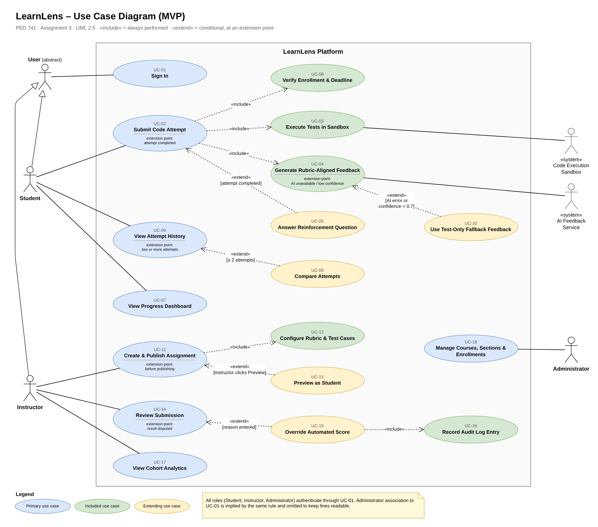
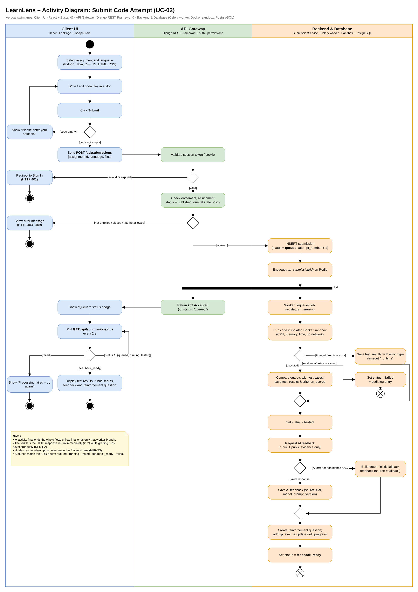
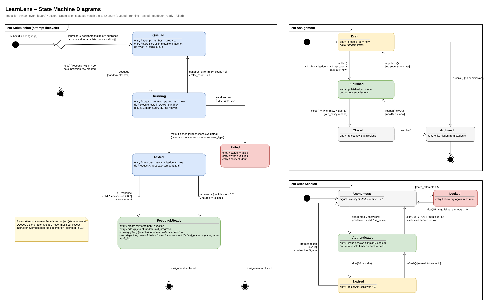

# Behavioral UML Models

Editable sources are `.drawio` files (open in draw.io desktop or [app.diagrams.net](https://app.diagrams.net)). PNG exports are for viewing on GitHub. Requirement IDs (FR / NFR) refer to [`../../specifications.md`](../../specifications.md).

| File | Diagram |
|---|---|
| `use-case-diagram.drawio` / `.png` | Use Case Diagram with «include» and «extend» |
| `activity-diagram-submit-code.drawio` / `.png` | Activity Diagram with swimlanes (Client UI · API Gateway · Backend & Database) |
| `state-machine-diagram.drawio` / `.png` | State machines: Submission, Assignment, User Session |

---

## 1 Use Case Diagram

**How to read it**

- **«include»** (base → included): the included behaviour *always* happens. Submitting code always verifies enrollment (UC-08), runs tests (UC-03) and generates feedback (UC-04).
- **«extend»** (extension → base): optional behaviour that happens only under a condition at an **extension point** shown inside the base use case. Example: UC-10 *Use Test-Only Fallback Feedback* extends UC-04 only when the AI fails or confidence < 0.7.
- **Actor generalization:** Student and Instructor inherit the *Sign In* use case from the abstract actor *User*.
- **Secondary actors** (right side) are external systems: the Code Execution Sandbox and the AI Feedback Service.

### 1.1 Tabular use case specifications

#### UC-02 Submit Code Attempt

| Field | Description |
|---|---|
| **ID / Name** | UC-02 Submit Code Attempt |
| **Primary actor** | Student |
| **Secondary actors** | Code Execution Sandbox, AI Feedback Service |
| **Stakeholders & interests** | Student: fast, understandable feedback. Instructor: feedback follows the rubric; hidden tests stay hidden. |
| **Preconditions** | Student is signed in (UC-01); assignment is published. |
| **Trigger** | Student clicks **Submit** on the assignment page. |
| **Main success scenario** | 1. Student selects a language and writes or uploads 1–10 files. 2. Student clicks Submit. 3. System checks the files are not empty. 4. System **includes UC-08** (verify enrollment, status, deadline). 5. System stores a new immutable attempt with status `queued` and returns *202 Accepted*. 6. UI shows "Queued" and polls the status. 7. System **includes UC-03** (run tests). 8. System **includes UC-04** (generate feedback). 9. System sets status `feedback_ready`. 10. UI shows test results, rubric scores and feedback. |
| **Extension points** | *attempt completed* (after step 9) → UC-05 Answer Reinforcement Question |
| **Alternative / exception flows** | 3a. Files empty → UI shows "Please enter your solution." and returns to step 1. 4a. Session invalid → 401, redirect to Sign In. 4b. Not enrolled → 403. 4c. Assignment closed or deadline passed and late not allowed → 409. 7a. Sandbox infrastructure error → retry up to 3 times, then status `failed`; previous attempts stay visible. |
| **Postconditions** | A new Submission with test results and feedback exists; XP and skill progress are updated. |
| **Business rules** | Attempts are never edited (FR-12). Hidden test data is never returned (NFR-S3). |
| **Non-functional** | 202 in ≤ 1 s (NFR-P2); test results ≤ 30 s (NFR-P3); feedback ≤ 90 s (NFR-P4). |
| **Requirements** | FR-10, FR-11, FR-12, FR-13, FR-15 |

#### UC-03 Execute Tests in Sandbox (included)

| Field | Description |
|---|---|
| **Primary actor** | Code Execution Sandbox (system) |
| **Preconditions** | A submission with status `queued` exists. |
| **Main success scenario** | 1. Worker dequeues the job and sets status `running`. 2. Worker starts an isolated container (no network, 1 CPU, 256 MB). 3. For each test case, the code runs with the test's stdin and time limit. 4. Output is compared with the expected output. 5. Test results and criterion auto points are stored. 6. Status is set to `tested`. |
| **Exceptions** | 3a. Time limit exceeded or runtime error → result stored with `error_type`; flow continues. 2a. Container fails to start → retry (max 3) → `failed`. |
| **Postconditions** | Every test case has a TestResult; every criterion has a CriterionScore. |
| **Requirements** | FR-13, FR-14, NFR-S1, NFR-A4 |

#### UC-04 Generate Rubric-Aligned Feedback (included)

| Field | Description |
|---|---|
| **Primary actor** | AI Feedback Service (system) |
| **Preconditions** | Submission status is `tested`. |
| **Main success scenario** | 1. FeedbackService builds a prompt from rubric criteria, feedback depth and **public** evidence only. 2. Sends it to the LLM with a 20 s timeout. 3. Validates the response format, confidence ≥ 0.7, and that no full solution is included. 4. Stores Feedback (`source = ai`, model, prompt version) with strength / issue / next-step items. |
| **Extension points** | *AI unavailable / low confidence* (at step 2–3) → UC-10 Use Test-Only Fallback Feedback |
| **Postconditions** | Exactly one Feedback exists for the submission. |
| **Requirements** | FR-15, FR-16, FR-17, FR-23 |

#### UC-05 Answer Reinforcement Question (extends UC-02)

| Field | Description |
|---|---|
| **Primary actor** | Student |
| **Extension condition** | `[attempt completed]` – submission reached `feedback_ready`. |
| **Main success scenario** | 1. System shows one multiple-choice question linked to the assignment skill or detected misconception. 2. Student selects an option. 3. System stores the answer, marks correct/incorrect and shows an explanation. 4. System adds practice XP. |
| **Alternative flows** | 2a. Student skips the question → no XP, can answer later from attempt history. |
| **Business rule** | Does not change official grades (FR-18). |

#### UC-11 Create & Publish Assignment

| Field | Description |
|---|---|
| **Primary actor** | Instructor |
| **Preconditions** | Instructor is enrolled in the course with role `instructor`. |
| **Main success scenario** | 1. Instructor creates a draft with title, instructions, due date, feedback depth and late policy. 2. System **includes UC-12** (configure rubric criteria and test cases). 3. Instructor clicks Publish. 4. System checks ≥ 1 criterion, ≥ 1 test case and due date in the future. 5. System sets status `published` and `published_at`. 6. Students in the course can see the assignment. |
| **Extension points** | *before publishing* (between 2 and 3) → UC-13 Preview as Student |
| **Exceptions** | 4a. Validation fails → HTTP 400 with list of missing items; assignment stays `draft`. |
| **Postconditions** | Assignment is published and accepts submissions. |
| **Requirements** | FR-06, FR-07, FR-08, FR-09 |

#### UC-15 Override Automated Score (extends UC-14)

| Field | Description |
|---|---|
| **Primary actor** | Instructor |
| **Extension condition** | `[reason entered]` while reviewing a submission (UC-14) whose result is disputed. |
| **Main success scenario** | 1. Instructor opens a criterion score. 2. Enters new points (0 … max points) and a reason. 3. System stores `final_points`, `overridden_by`, `overridden_at`. 4. System **includes UC-16** (append audit log entry). 5. Student sees the updated score. |
| **Exceptions** | 2a. Reason empty → HTTP 400. 2b. Points outside 0 … max → HTTP 400. |
| **Requirements** | FR-21, FR-23 |

---

## 2 Activity Diagram – Submit Code Attempt

- **Three vertical swimlanes:** *Client UI* (React, `LabPage`, Zustand `useAppStore`), *API Gateway* (DRF authentication + permissions), *Backend & Database* (SubmissionService, Celery worker, Docker sandbox, PostgreSQL).
- **Decision nodes** carry guards in square brackets, e.g. `[invalid or expired]`, `[AI error or confidence < 0.7]`.
- **Merge nodes** join alternative paths (timeout vs. executed; AI vs. fallback).
- **Fork:** after the job is queued, the API returns *202 Accepted* immediately while the worker grades in parallel (NFR-P2). The client polls until the status is final.
- **Final nodes:** ◉ activity final ends the whole activity (client side); ⊗ flow final ends only the worker branch.

---

## 3 State Machine Diagrams

### 3.1 Submission (main entity)
States match the `submissions.status` enum in the ERD: **Queued → Running → Tested → FeedbackReady**, plus **Failed**.

| From | Event [guard] / action | To |
|---|---|---|
| ● (choice) | `submit(files, language)` [enrolled ∧ published ∧ (now ≤ due_at ∨ late allowed)] | Queued |
| ● (choice) | [else] / respond 403 or 409 | ◉ (no submission created) |
| Queued | `dequeue` [sandbox slot free] | Running |
| Running | `sandbox_error` [retry_count < 3] / retry_count += 1 | Queued |
| Running | `sandbox_error` [retry_count ≥ 3] | Failed |
| Running | `tests_finished` [all test cases evaluated] | Tested |
| Tested | `ai_response` [valid ∧ confidence ≥ 0.7] / source := ai | FeedbackReady |
| Tested | `ai_error` ∨ [confidence < 0.7] / source := fallback | FeedbackReady |
| FeedbackReady | `override(points, reason)` [role = instructor ∧ reason ≠ ''] / write audit_log | FeedbackReady (internal) |
| FeedbackReady, Failed | `assignment archived` | ◉ |

### 3.2 Assignment
`Draft → Published → Closed → Archived`, with guards on `publish()` (≥ 1 criterion ∧ ≥ 1 test ∧ due_at > now), `unpublish()` [no submissions yet], `reopen(newDue)` [newDue > now], and `archive()` from Draft only when there are no submissions.

### 3.3 User Session
`Anonymous → Authenticated → Expired`, plus `Locked` after 5 failed sign-ins (unlocks after 15 min). Sign-out invalidates the server session (`POST /auth/sign-out`), matching the note in `frontend/src/services/api.ts`.
