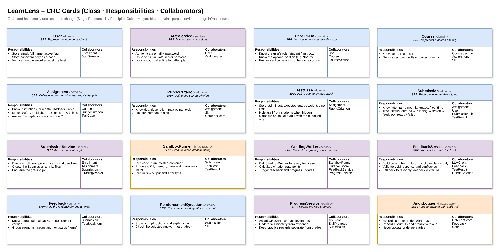
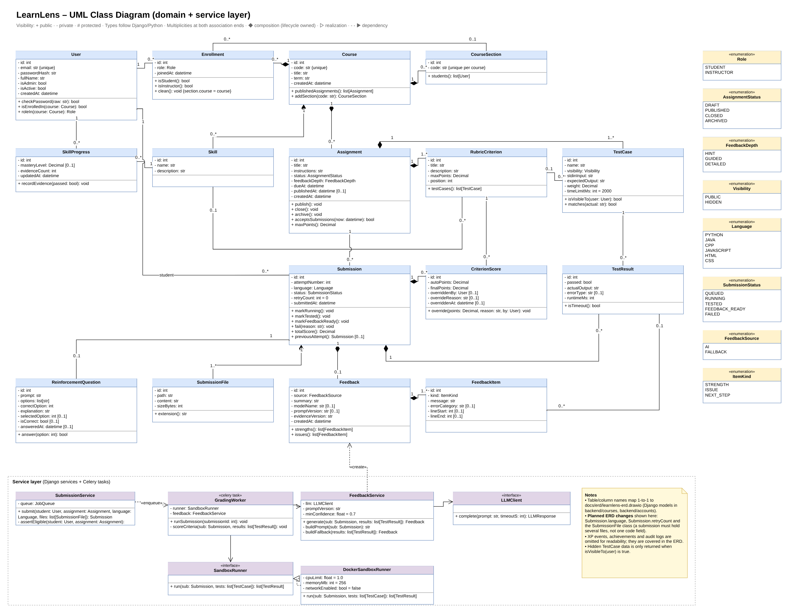
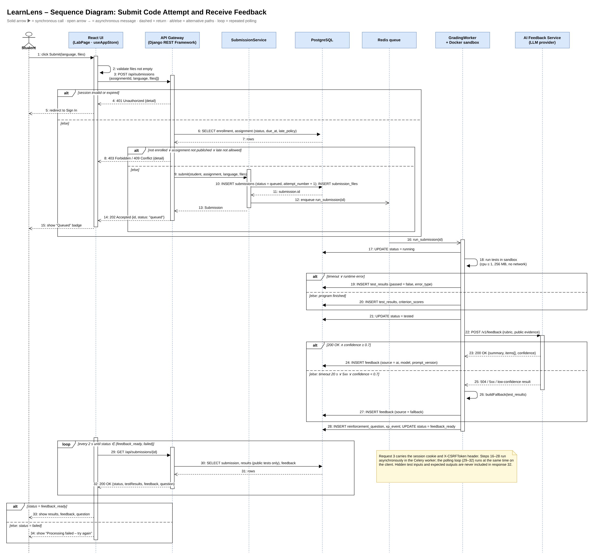

# Structural & Data Flow UML Models

Editable sources are `.drawio` files; PNG exports are for GitHub viewing. Requirement IDs refer to [`../../specifications.md`](../../specifications.md).

| File | Diagram |
|---|---|
| `crc-cards.drawio` / `.png` | 16 CRC cards (also as tables below) |
| `class-diagram.drawio` / `.png` | Typed UML class diagram (domain + service layer) |
| `sequence-diagram-submit-code.drawio` / `.png` | Sequence diagram: submit code → feedback, with alt/else and loop |

---

## 1 CRC Cards

**Single Responsibility Principle check.** Each class has one reason to change:

- *Domain* classes only hold data and rules about themselves (e.g. `TestCase` decides its own visibility).
- *Service* classes coordinate one workflow each: accepting an attempt (`SubmissionService`), grading it (`GradingWorker`), producing feedback (`FeedbackService`), updating progress (`ProgressService`).
- *Infrastructure* classes isolate risky or external work: running untrusted code (`SandboxRunner`) and the audit trail (`AuditLogger`).
- Grading and feedback are deliberately split: if the AI provider changes, only `FeedbackService` / `LLMClient` change, never the grading logic.

### User  ·  _Domain_

**Single responsibility:** Represent one person's identity

| Responsibilities | Collaborators |
|---|---|
| Store email, full name, active flag | Enrollment |
| Store password only as a hash | AuthService |
| Verify a raw password against the hash |  |

### AuthService  ·  _Service_

**Single responsibility:** Manage sign-in sessions

| Responsibilities | Collaborators |
|---|---|
| Authenticate email + password | User |
| Issue and invalidate server sessions | AuditLogger |
| Lock account after 5 failed attempts |  |

### Enrollment  ·  _Domain_

**Single responsibility:** Link a user to a course with a role

| Responsibilities | Collaborators |
|---|---|
| Know the user's role (student / instructor) | User |
| Know the optional section (e.g. “02 P”) | Course |
| Ensure section belongs to the same course | CourseSection |

### Course  ·  _Domain_

**Single responsibility:** Represent a course offering

| Responsibilities | Collaborators |
|---|---|
| Know code, title and term | CourseSection |
| Own its sections, skills and assignments | Assignment |
|  | Skill |

### Assignment  ·  _Domain_

**Single responsibility:** Define one programming task and its lifecycle

| Responsibilities | Collaborators |
|---|---|
| Know instructions, due date, feedback depth | Course |
| Move Draft → Published → Closed → Archived | RubricCriterion |
| Answer “accepts submissions now?” | TestCase |

### RubricCriterion  ·  _Domain_

**Single responsibility:** Define one scored criterion

| Responsibilities | Collaborators |
|---|---|
| Know title, description, max points, order | Assignment |
| Link the criterion to a skill | Skill |
|  | CriterionScore |

### TestCase  ·  _Domain_

**Single responsibility:** Define one automated check

| Responsibilities | Collaborators |
|---|---|
| Store stdin input, expected output, weight, time limit | Assignment |
| Hide itself from students when hidden | RubricCriterion |
| Compare an actual output with the expected one |  |

### Submission  ·  _Domain_

**Single responsibility:** Record one immutable attempt

| Responsibilities | Collaborators |
|---|---|
| Know attempt number, language, files, time | Assignment |
| Track status: queued → running → tested → feedback_ready / failed | User |
|  | SubmissionFile |
|  | TestResult |

### SubmissionService  ·  _Service_

**Single responsibility:** Accept a new attempt

| Responsibilities | Collaborators |
|---|---|
| Check enrollment, publish status and deadline | Enrollment |
| Create the Submission and its files | Assignment |
| Enqueue the grading job | Submission |
|  | GradingWorker |

### SandboxRunner  ·  _Infrastructure_

**Single responsibility:** Execute untrusted code safely

| Responsibilities | Collaborators |
|---|---|
| Run code in an isolated container | Submission |
| Enforce CPU, memory, time and no-network limits | TestCase |
| Return raw output and error type | TestResult |

### GradingWorker  ·  _Service_

**Single responsibility:** Orchestrate grading of one attempt

| Responsibilities | Collaborators |
|---|---|
| Call SandboxRunner for every test case | SandboxRunner |
| Calculate criterion auto points | CriterionScore |
| Trigger feedback and progress updates | FeedbackService |
|  | ProgressService |

### FeedbackService  ·  _Service_

**Single responsibility:** Turn evidence into feedback

| Responsibilities | Collaborators |
|---|---|
| Build prompt from rubric + public evidence only | LLMClient |
| Validate LLM response and confidence | Feedback |
| Fall back to test-only feedback on failure | TestResult |
|  | RubricCriterion |

### Feedback  ·  _Domain_

**Single responsibility:** Hold the feedback for one attempt

| Responsibilities | Collaborators |
|---|---|
| Know source (ai / fallback), model, prompt version | Submission |
| Group strengths, issues and next steps (items) | FeedbackItem |

### ReinforcementQuestion  ·  _Domain_

**Single responsibility:** Check understanding after an attempt

| Responsibilities | Collaborators |
|---|---|
| Store prompt, options and explanation | Submission |
| Check the selected answer (not graded) | Skill |

### ProgressService  ·  _Service_

**Single responsibility:** Update practice progress

| Responsibilities | Collaborators |
|---|---|
| Award XP events and achievements | XpEvent |
| Update skill mastery from evidence | SkillProgress |
| Keep practice rewards separate from grades | Submission |

### AuditLogger  ·  _Infrastructure_

**Single responsibility:** Keep an append-only audit trail

| Responsibilities | Collaborators |
|---|---|
| Record score overrides with reason | CriterionScore |
| Record AI outputs and prompt versions | Feedback |
| Never update or delete entries | User |

---

## 2 Class Diagram

**Conventions**

- Visibility: `-` private attribute, `+` public operation. Every attribute is typed (`int`, `str`, `Decimal`, `datetime`, enumerations); every operation shows parameters and return type.
- Multiplicities are written at **both** ends of each association, e.g. `Assignment 1 ◆— 1..* RubricCriterion`, `Submission 1 — 0..1 Feedback`, `CourseSection 0..1 — 0..* Enrollment`.
- ◆ **Composition** is used when the part cannot exist without the whole (deleting an Assignment deletes its rubric criteria and test cases; deleting a Submission deletes its files and results). Plain associations are used for independent objects (User ↔ Submission).
- `«interface» SandboxRunner` is **realized** by `DockerSandboxRunner`, so another sandbox technology can be plugged in without changing `GradingWorker`.
- Enumerations (`Role`, `AssignmentStatus`, `FeedbackDepth`, `Visibility`, `Language`, `SubmissionStatus`, `FeedbackSource`, `ItemKind`) match the enum values in the ERD and Django models.

**Consistency with the code / ERD.** Class and attribute names follow `backend/courses/models.py`, `backend/accounts/models.py` and `docs/erd/learnlens-erd.drawio`. Three additions are planned and should be added to the ERD in the same PR as the migration:

1. `Submission.language` – needed for FR-10 (the frontend already sends a language).
2. `Submission.retryCount` – needed for automatic retries (NFR-A4).
3. `SubmissionFile` – a submission must hold several files, not a single `code` column.

---

## 3 Sequence Diagram – Submit Code Attempt and Receive Feedback

**Participants:** Student · React UI · API Gateway (DRF) · SubmissionService · PostgreSQL · Redis queue · GradingWorker + Docker sandbox · AI Feedback Service.

**Chronological HTTP flow**

| Step | Message | HTTP / result |
|---|---|---|
| 3 | `POST /api/submissions {assignmentId, language, files[]}` | request with session cookie + CSRF token |
| 4 | session invalid | `401 Unauthorized` |
| 8 | not enrolled / not published / late | `403 Forbidden` / `409 Conflict` |
| 14 | attempt stored and queued | `202 Accepted {id, status: "queued"}` |
| 22 | worker → AI `POST /v1/feedback` | `200 OK` or `504 / 5xx` |
| 29–32 | `GET /api/submissions/{id}` every 2 s | `200 OK {status, testResults, feedback, question}` |

**Combined fragments**

- `alt [session invalid] / else` with a **nested** `alt [not enrolled ∨ not published ∨ late] / else` – the gateway's error paths.
- `alt [timeout ∨ runtime error] / else` – sandbox result handling.
- `alt [200 OK ∧ confidence ≥ 0.7] / else [timeout ∨ 5xx ∨ low confidence]` – AI feedback with deterministic fallback (FR-16).
- `loop [every 2 s until status ∈ {feedback_ready, failed}]` – client polling, followed by `alt [feedback_ready] / else [failed]` for what the student sees.

Messages 16–28 are asynchronous (Celery) and run while the client polls; activation bars show when each participant is busy.
